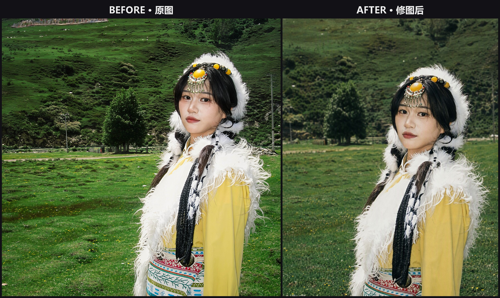

# portrait-retouch · 人像 P 图 Skill / Portrait Retouching Skill

**让 AI 修出"不像 AI 修"的人像照片。** 一个以"去 AI 味"为第一准则的 agent skill：
先分析、后提问、出方案再动手，成片像专业修图师的作品，而不是 AI 生成图。

**AI portrait retouching that doesn't look AI.** An agent skill with "removing the AI look" as its
prime directive: analyze first, interview before editing, present plans before touching a pixel —
output that reads like a professional retoucher's work, not an AI generation.



> 真实案例：高原藏装旅拍 → 二次构图 + 五官自然微调 + 藏地电影感 + 胶片 CCD 滤镜（详见 [references/cases.md](references/cases.md) 案例 9）
>
> Real case: plateau Tibetan-costume travel shot → recomposition + subtle feature tuning + Tibetan cinematic mood + film CCD filter (see case 9 in [references/cases.md](references/cases.md))

## 为什么值得用 / Why This Skill

- 🚫 **去 AI 味是第一准则** — 完整的负面清单、成片 10 条自查清单、真实感提示词规范，出图前后各过一遍
- 🔍 **先诊断后动手** — 收到照片先输出逐项分析（光线/皮肤/五官/构图/背景），给修改建议，不擅自开修
- 💬 **五轮引导式提问** — 修哪里 → 怎么修（程度+保留项）→ 整体风格 → 选滤镜 → 补充确认
- 📋 **3 套详细方案再选** — 每套写满"修哪里/怎么修/改后效果/适合场景/风险提醒"，选定后才生成
- 🎞️ **16 个滤镜模板** — 冷白皮、港风、CCD、法式、霓虹夜景、美式 yearbook……即选即用
- 📚 **真实案例集** — 9 个"分析→方案→预期效果"完整标注案例，含真实前后对比图，可直接扩充为微调训练集

EN:
- 🚫 **Anti-AI-look first** — a full negative list, a 10-item post-generation checklist and realism prompt specs, checked before and after every generation
- 🔍 **Diagnose before touching** — every photo gets an itemized analysis (light/skin/features/composition/background) with recommendations; no unauthorized edits
- 💬 **Five-round guided interview** — where → how (degree + keep-list) → style → filter → supplements
- 📋 **Three detailed plans before generating** — each plan fills in "where / how / expected result / best for / risks"; generation starts only after a plan is picked
- 🎞️ **16 filter templates** — cool fair, HK retro, CCD, French chic, neon night, American yearbook… pick and go
- 📚 **Real casebook** — 9 fully annotated "analysis → plan → expected result" cases with real before/after material, ready to extend into a fine-tuning dataset

## 工作流程 / Workflow

```
收到照片
  └─ ① 完整分析（问题诊断 + 推荐方向）
       └─ ② 第 1 问：修哪里
            └─ ③ 第 2 问：怎么修（程度 + 保留项）
                 └─ ④ 第 3 问：整体风格
                      └─ ⑤ 第 4 问：选滤镜（16 模板快选）
                           └─ ⑥ 第 5 问：补充确认
                                └─ ⑦ ≥3 套详细方案 → 用户选定
                                     └─ ⑧ 生成 → 去 AI 味自查 → 迭代
```

EN:
```
Photo received
  └─ ① Full analysis (diagnosis + recommendations)
       └─ ② Q1: what to edit
            └─ ③ Q2: how (degree + keep-list)
                 └─ ④ Q3: overall style
                      └─ ⑤ Q4: pick a filter (16 templates)
                           └─ ⑥ Q5: supplements & confirmation
                                └─ ⑦ ≥3 detailed plans → user picks
                                     └─ ⑧ Generate → anti-AI checklist → iterate
```

## 目录结构 / Structure

```
portrait-retouch/
├── SKILL.md                    # 主流程 / Main workflow (bilingual)
├── references/
│   ├── anti-ai.md              # 去 AI 味规范（最高优先级）/ Anti-AI-look spec (top priority)
│   ├── cases.md                # 案例集（分析→方案→效果，训练集格式）/ Casebook (analysis→plan→result)
│   ├── interview-script.md     # 五轮提问剧本 / Five-round interview script
│   ├── style-library.md        # 16 个滤镜模板 / 16 filter templates
│   └── retouch-playbook.md     # 分区修图技法 + 方案匹配 / Region playbook + plan matching
├── assets/cases/               # 真实前后对比素材 / Real before-after material
├── install.ps1                 # Windows 一键安装 / One-click install (Windows)
└── install.sh                  # macOS / Linux 一键安装 / One-click install (macOS/Linux)
```

## 一键安装 / One-Click Install

**Windows（Kimi Work）：**

```powershell
git clone https://github.com/Allen-Chen-coder/portrait-retouch.git
cd portrait-retouch
powershell -ExecutionPolicy Bypass -File .\install.ps1
```

**macOS / Linux：**

```bash
git clone https://github.com/Allen-Chen-coder/portrait-retouch.git
cd portrait-retouch
bash install.sh
```

安装后重启 Kimi Work（或新开一个会话），上传人像照片并说"帮我 P 图 / retouch this photo"即可触发。
/ After installing, restart Kimi Work (or open a new session), upload a portrait and say
"帮我 P 图 / retouch this photo" to trigger.

## 使用示例 / Example Session

> "帮我修一下这张照片"
> → agent 先给出照片分析（"逆光导致面部偏暗、皮肤有油光、构图人物偏小……"）
> → 三轮提问（修哪里 / 怎么修 / 风格）→ 选滤镜 → 补充确认
> → 3 套详细方案（自然档 / 出片档 / 大胆档）→ 选定后出图 → 迭代到满意

EN:
> "Retouch this photo for me"
> → the agent starts with an analysis ("backlit face is dark, oily shine, subject too small in frame…")
> → three questions (where / how / style) → filter pick → supplements
> → 3 detailed plans (subtle / polished / bold) → generate after you pick → iterate until satisfied

## 适配平台 / Compatibility

任何支持 SKILL.md 技能的 agent 运行时（Kimi Work、Kimi Code CLI 及兼容的 skills 目录规范）。
/ Any agent runtime that supports SKILL.md-style skills (Kimi Work, Kimi Code CLI, and compatible
skills-directory conventions).

---

如果觉得有用，欢迎 Star ⭐ 和分享 —— 每一个真实使用案例都会让 [references/cases.md](references/cases.md) 的案例集更完整。
/ If you find this useful, a Star ⭐ and a share are much appreciated — every real usage makes the
casebook in [references/cases.md](references/cases.md) richer.
