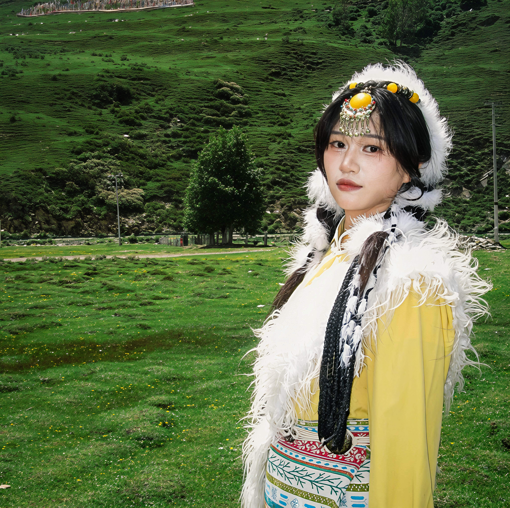
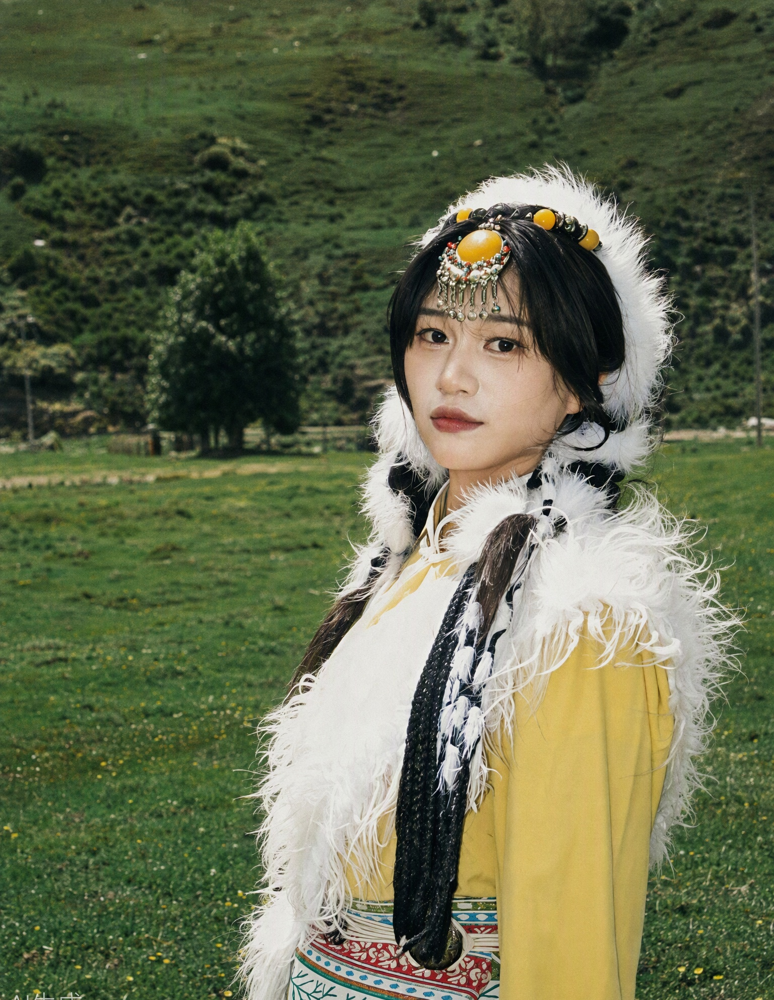

# 人像修图案例集（分析 → 方案 → 预期效果）/ Portrait Retouch Casebook (Analysis → Plan → Expected Result)

> 用途：① 作为模型微调的训练素材格式范本——每张案例都是"照片 → 问题诊断 → 修改动作 →
> 预期效果"的完整标注；② 分析用户原图时对照本集找相似案例，直接套用诊断框架和方案结构。
> 案例整理自公开修图教程社区（小红书、知乎、公众号教程）中最常见的前后对比案例模式，
> 以及本 skill 实测过的真实案例。读用户照片前先浏览本文件，找 1–2 个最接近的案例做锚点。
>
> **EN:** Purpose: ① a format template for fine-tuning data — each case is a complete annotation of
> "photo → problem diagnosis → edit actions → expected result"; ② when analyzing a user's photo, find
> similar cases here and reuse their diagnostic frames and plan structures. Cases are compiled from the
> most common before/after patterns in public retouching communities (Xiaohongshu/RED, Zhihu, WeChat
> tutorials) plus real cases verified by this skill. Skim this file before reading a user's photo and
> anchor on the 1–2 closest cases.

## 目录 / Contents
1. 逆光大黑脸（户外旅拍）/ Backlit dark face (outdoor travel)
2. 磨皮过度的假脸自拍 / Over-smoothed fake-face selfie
3. 室内顶光：油光 + 黑眼圈 / Indoor top light: oil shine + dark circles
4. 夜景街拍的蜡黄脸 / Night street shot with sallow skin
5. 表情僵硬的求职形象照 / Stiff job headshot
6. 全身穿搭照：构图松 + 灰蒙蒙 / Full-body outfit shot: loose composition + gray cast
7. 褪色老照片翻新 / Faded old photo restoration
8. 多人合影只修自己 / Group photo — retouch only me
9. 高原旅拍：人物融进背景、锐化重（真实实测案例）/ Plateau travel shot: subject blends into background, over-sharpened (verified real case)

---

## 1. 逆光大黑脸（户外旅拍）/ Backlit dark face (outdoor travel)
- **照片 / Photo**：夕阳下沙漠/海边拍半身人像，背景天空过曝发白，人物面部欠曝偏黑，头发边缘有轮廓光。/ Half-body portrait at sunset in a desert/by the sea; sky blown out, face underexposed and dark, rim light on hair.
- **问题诊断 / Diagnosis**：① 面部欠曝 1–2 档，五官隐没在阴影里 / face 1–2 stops underexposed; ② 背景高光溢出，没有细节 / blown highlights, no detail; ③ 光比过大，画面生硬 / harsh contrast.
- **修改动作 / Actions**：提亮面部阴影（保持日光方向不变，只提暗部）；压背景高光找回天空层次；HSL 提橙色明度让肤色从黑黄变通透；最后 S 曲线 + 轻颗粒出胶片感。/ Lift facial shadows (keep sun direction, lift shadows only); pull down sky highlights; raise orange luminance in HSL for translucent skin; finish with an S-curve and light grain for a film feel.
- **预期效果 / Expected result**：脸亮起来但光感还是夕阳的方向，不是棚拍平光；背景有色彩层次；整体像"本来就是黄金时刻拍的"。/ Face brightens while the light still reads as golden hour; layered background; looks natively shot at golden hour.
- **套用模板 / Templates**：1 日常清透 / 4 日系 / 8 法式；风格库"方案匹配速查"中夜景/户外条目。

## 2. 磨皮过度的假脸自拍 / Over-smoothed fake-face selfie
- **照片 / Photo**：前置摄像头自拍，皮肤已经磨得发亮，配重滤镜，塑料感明显。/ Front-camera selfie with glowing over-smoothed skin and a heavy filter; obvious plastic feel.
- **问题诊断 / Diagnosis**：① 皮肤零纹理，像硅胶 / zero skin texture, silicone-like; ② 滤镜色偏重，肤色发橙 / heavy color cast, orange skin; ③ 锐化 + 磨皮并存，又糊又硬 / sharpening plus smoothing at once, mushy yet harsh.
- **修改动作 / Actions**：这类"修过头"图**以退为进**：重建皮肤纹理和颗粒；把色偏拉回自然肤色；降低锐化。属于"修复过度修图"，要提醒用户成片会"变回真实肤质"，不是"更美"。/ For over-edited images, retreat to advance: rebuild skin texture and grain; pull color back to natural skin tone; reduce sharpening. This is "repairing over-retouching" — warn the user the result will return to real skin texture, not "prettier".
- **预期效果 / Expected result**：像没开美颜的手机原图，但肤色均匀、气色好。/ Like an un-beautified phone original, but with even tone and healthy glow.
- **套用模板 / Templates**：1 日常清透（唯一推荐，别再叠风格）/ Natural Clean only — do not stack styles.

## 3. 室内顶光：油光 + 黑眼圈 / Indoor top light: oil shine + dark circles
- **照片 / Photo**：餐厅/商场顶灯下自拍，T 区反光明显，眼窝和鼻翼阴影重，显得疲惫。/ Selfie under restaurant/mall downlights; shiny T-zone, heavy eye-socket and nose-wing shadows, tired look.
- **问题诊断 / Diagnosis**：① 顶光造成眼窝、法令纹阴影加深 / downlight deepens eye-socket and nasolabial shadows; ② 鼻梁额头油光抢镜 / distracting nose-bridge and forehead shine; ③ 白平衡偏冷或偏黄不一 / inconsistent white balance.
- **修改动作 / Actions**：压 T 区高光、轻度提眼下周和法令纹阴影；均匀肤色；不动五官结构。顶光阴影只能减淡不能消除，否则等于换了一张脸。/ Suppress T-zone highlights, lightly lift under-eye and nasolabial shadows; even the skin tone; never touch feature structure. Downlight shadows can only be reduced, not erased — erasing equals swapping the face.
- **预期效果 / Expected result**：气色精神一个档次，但看得出还是在餐厅拍的，不假。/ A visibly fresher look, yet still believably shot in that restaurant.
- **套用模板 / Templates**：2 冷白皮（偏黄时）/ 3 奶油肌（偏冷时）/ Cool Fair (when yellow) / Creamy Warm (when cold).

## 4. 夜景街拍的蜡黄脸 / Night street shot with sallow skin
- **照片 / Photo**：夜晚街边，路灯/招牌混合光源，脸被环境光染得蜡黄或发绿，噪点多。/ Night street; mixed lamp/sign lighting dyes the face sallow or green; heavy noise.
- **问题诊断 / Diagnosis**：① 混合光源色温乱，肤色被染色 / chaotic mixed color temperatures; ② 高 ISO 噪点 / high-ISO noise; ③ 容易修成"强行变白"的假脸 / easy to botch into a force-whitened fake face.
- **修改动作 / Actions**：先统一肤色（去环境色染，不是美白）；保留一部分噪点维持夜景质感；用 12 夜景霓虹模板的 teal-orange 对冲思路调色，把"缺点"转成"氛围"。/ Unify skin tone first (remove environmental dye, NOT whiten); keep some noise for night texture; grade with the teal-orange contrast of template 12 to turn flaws into mood.
- **预期效果 / Expected result**：蜡黄变成被霓虹氛围包裹的健康肤色，像电影截图而不是事故照。/ Sallow turns into neon-wrapped healthy skin — a film still, not an accident shot.
- **套用模板 / Templates**：12 夜景霓虹 / 6 港风 / Neon Night / HK Retro.

## 5. 表情僵硬的求职形象照 / Stiff job headshot
- **照片 / Photo**：正装照，表情紧张、肩膀端、背景杂乱（公司前台/打印店背景）。/ Formal attire, tense expression, raised shoulders, messy background.
- **问题诊断 / Diagnosis**：① 表情僵，但**表情不能改**（改了就是假照）；② 背景杂乱降低专业感；③ 衣服褶皱多。/ Stiff — but the expression must NOT change (changing it makes a fake); messy background kills professionalism; wrinkled clothes.
- **修改动作 / Actions**：换干净中性背景（浅灰/浅蓝），注意发丝边缘和肩线融合；抚平衣皱；提亮面部让精神一点；**表情、五官一律不动**。/ Swap in a clean neutral backdrop (light gray/blue) with careful hair-edge and shoulder blending; smooth clothing; brighten the face; expression and features stay untouched.
- **预期效果 / Expected result**：同一个人、同一个表情，但像换到了专业照相馆。/ Same person, same expression — but as if shot at a professional studio.
- **套用模板 / Templates**：11 形象照 / 14 美式 yearbook（想走松弛感时）/ Professional Headshot / American Yearbook (for a relaxed vibe).

## 6. 全身穿搭照：构图松 + 灰蒙蒙 / Full-body outfit shot: loose composition + gray cast
- **照片 / Photo**：对镜或 tripod 全身照，人物占比小，画面灰、没有重点，为了显腿长仰拍导致背景线条歪。/ Mirror or tripod full-body shot; subject under a third of the frame; gray flat tone; tilted background lines from a low angle.
- **问题诊断 / Diagnosis**：① 人物占比不足三分之一 / subject under 1/3; ② 影调灰平 / flat gray tone; ③ 仰拍透视让门框/货架倾斜（修身材时这些线不能弯）。/ low-angle perspective tilts doors/shelves — these lines must not bend when the body is slimmed.
- **修改动作 / Actions**：二次构图裁到 2:3 或 3:4，人物占比拉到一半以上；ins 灰调调色但保唇色和肤色健康；体态微调（站直、收肩），背景直线必须保持笔直。/ Recompose to 2:3 or 3:4 with the subject filling over half; minimalist gray grade but keep lips and skin healthy; nudge posture (stand tall, shoulders back); background straight lines must stay straight.
- **预期效果 / Expected result**：穿搭细节看得清，画面有博主感。/ Outfit details read clearly; the frame has creator energy.
- **套用模板 / Templates**：9 ins 灰调 / 5 韩系画报 / Minimalist Gray / Korean Editorial.

## 7. 褪色老照片翻新 / Faded old photo restoration
- **照片 / Photo**：多年前的照片或扫描件，褪色偏色、有划痕、分辨率低。/ Old photo or scan: faded, color-shifted, scratched, low resolution.
- **问题诊断 / Diagnosis**：① 颜色信息大面积缺失 / large color information loss; ② 划痕和霉斑 / scratches and mold spots; ③ 修的最大风险是"修成现代数码照"，失去纪念意义。/ the biggest risk is "restoring" it into a modern digital photo, destroying its memento value.
- **修改动作 / Actions**：修复划痕污渍；肤色和场景色只做到"当年冲印的正常水平"，不追求鲜艳；**保留颗粒感和年代色偏**；不要去噪到干净。/ Repair scratches and spots; bring skin and scene colors only to "a well-preserved print of its era", not vivid; keep grain and era color cast; never denoise to sterility.
- **预期效果 / Expected result**：像保存得很好的老照片，而不是新拍的。/ Like a well-preserved old photo, not a new shoot.
- **套用模板 / Templates**：7 胶片 CCD（注意只做轻覆层）/ Film CCD as a light overlay only.

## 8. 多人合影只修自己 / Group photo — retouch only me
- **照片 / Photo**：闺蜜/家庭/同学聚会合影，用户要求"只修我"。/ Friends/family/class reunion photo; the user asks to "fix only me".
- **问题诊断 / Diagnosis**：最大风险是模型顺手"优化"了所有人，或者边缘穿帮。/ the biggest risk is the model "optimizing" everyone, or edge artifacts.
- **修改动作 / Actions**：提示词必须显式写 only modify the person indicated, all other faces completely unchanged；修自己时也用"自然微调"档，避免你修了别人没修，对比之下你像 AI 脸。/ The prompt must explicitly state: only modify the person indicated, all other faces completely unchanged. Retouch yourself at the "subtle" level too — if you polish only yourself, the contrast makes you look like the AI face.
- **预期效果 / Expected result**：只有自己变好看了，其他人原样，整体自然。/ Only you look better; everyone else untouched; the photo stays natural.
- **套用模板 / Templates**：视场景，但一律轻修。/ Depends on the scene, but always subtle.

## 9. 高原旅拍：人物融进背景、锐化重（真实实测案例）/ Plateau travel shot: subject blends into background, over-sharpened (verified real case)
- **照片 / Photo**：白天高原草甸，穿民族服饰（藏装）半身照，人物在画面一侧，绿色背景占比大，光线平，数码锐化重，人物和背景"糊成一片"。/ Daytime plateau meadow; half-body shot in Tibetan costume; subject off to one side; green dominates; flat light; heavy digital sharpening; subject and background merge into one mass.
- **问题诊断 / Diagnosis**：① 人物占比小，视线被大片绿色带走 / small subject, green pulls the eye away; ② 光线平无层次，锐化重有数码感 / flat light, digital sharpening; ③ 五官被强对比的高光阴影切得有点怪（鼻梁高光硬、眼睛无神）。/ features cut by harsh highlight/shadow contrast (hard nose-bridge highlight, dull eyes).
- **修改动作 / Actions**：二次构图裁 3:4 竖版，人物占比加大；降锐化，柔和通透；眼睛加自然眼神光、柔化鼻梁硬高光，不动五官结构；胶片/CCD 滤镜出颗粒和怀旧色偏，压掉数码味。/ Recompose to 3:4 vertical with a larger subject; reduce sharpening for softness; add natural catchlights and soften the nose-bridge highlight without touching feature structure; film/CCD grain and nostalgic cast to kill the digital feel.
- **预期效果 / Expected result**：像"藏地旅行电影剧照"——草甸深绿、人物突出、有胶片颗粒，同时人还是本人。/ Like a still from a Tibetan travel film — deep greens, prominent subject, film grain, and still unmistakably the same person.
- **套用模板 / Templates**：7 胶片 CCD + 藏地电影感；方案匹配速查中"户外阳光"行的变体。/ Film CCD + Tibetan cinematic mood; a variant of the "outdoor sunlight" row in the matching table.
- **备注 / Note**：此案例实测于 2026-10，用户选择的组合是"构图加大 + 五官微调 + 电影感 + CCD 滤镜"，成片通过去 AI 味自查。
  / Verified in Oct 2026; the user picked "bigger subject + subtle feature tuning + cinematic mood + CCD filter"; the output passed the anti-AI checklist.

前后对比实拍素材（真实案例原图与成片）/ Real before/after material:

| 修图前 / Before | 修图后 / After |
|---|---|
|  |  |

---

## 使用本案例集的方法 / How to Use This Casebook

1. **分析用户原图时**：先找构图/光线/场景最接近的 1–2 个案例，借用其"问题诊断"的分点框架，
   但不照搬结论——一切以实际照片为准。/ When analyzing the user's photo: find the 1–2 closest cases by
   composition/light/scene and borrow their diagnosis structure — never copy conclusions; the actual photo rules.
2. **出方案时**：方案的结构（修哪里 → 怎么修 → 改后效果 → 适合场景）与案例的
   "问题诊断 → 修改动作 → 预期效果"一一对应，用户读方案时就知道"改完长什么样"。/ When writing plans:
   the plan structure (where → how → result → best-for) mirrors the case structure (diagnosis → actions →
   expected result), so the user knows what the edit will look like.
3. **训练集格式**：如需把本文件用于模型微调，每张案例即一条标注样本，
   格式为 [照片描述 | 问题诊断 | 修改动作 | 预期效果 | 标签]，可按需扩充到 20–50 张。/ Fine-tuning format:
   each case is one labeled sample in the form [photo description | diagnosis | actions | expected result | tags];
   expand to 20–50 samples as needed.
